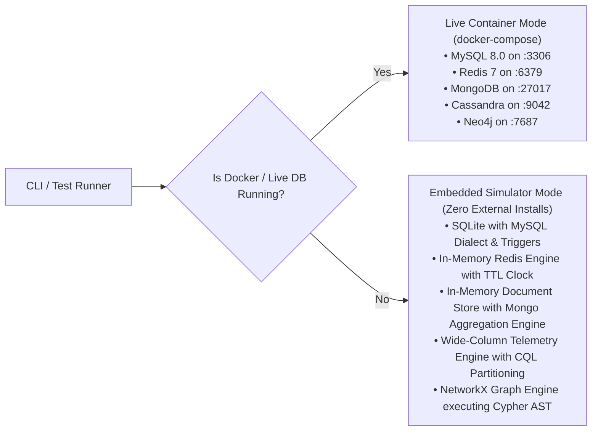

# Integrated Airline Reservation & Flight Management System (IARFMS)
## Master Engineering Guide, Architecture Blueprint & 24-Hour Implementation Roadmap

> **Author**: Senior Database Architect & Systems Engineer  
> **Course / Subject**: Database Management Systems (Advanced Lab & Capstone)  
> **Project Scope**: Group 4 – Relational, Procedural, High-Performance, Concurrent, Polyglot NoSQL & Distributed Airline System  
> **Target Marks**: 100 / 100  
> **Target Execution Window**: 24-Hour High-Velocity Engineering Sprint  

---

## Table of Contents
1. [Executive Summary & System Vision](#1-executive-summary--system-vision)
2. [Agent Autonomy vs. Human Attention: The Honest Breakdown](#2-agent-autonomy-vs-human-attention-the-honest-breakdown)
3. [The 24-Hour Hour-by-Hour Sprint Roadmap](#3-the-24-hour-hour-by-hour-sprint-roadmap)
4. [Master Architectural Blueprint](#4-master-architectural-blueprint)
5. [Deep Dive: Experiment-by-Experiment Specifications](#5-deep-dive-experiment-by-experiment-specifications)
   - [Experiment 1: Relational Database Core (SQL DDL/DML, JOINs, RBAC, TCL)](#experiment-1-relational-database-core)
   - [Experiment 2: Advanced Procedural MySQL (Views, Triggers, SP, Functions, Cursors)](#experiment-2-advanced-procedural-mysql)
   - [Experiment 3: Performance Optimization (EXPLAIN, B-Tree, SHA256 Hash, Benchmarks)](#experiment-3-performance-optimization)
   - [Experiment 4: Concurrency & Transaction Management (ACID, Locks, Deadlock, MVCC)](#experiment-4-concurrency--transaction-management)
   - [Experiment 5: Multi-Model Polyglot NoSQL (Redis & MongoDB)](#experiment-5-multi-model-polyglot-nosql-redis--mongodb)
   - [Experiment 6: Wide-Column & Graph Engines (Cassandra & Neo4j)](#experiment-6-wide-column--graph-engines-cassandra--neo4j)
   - [Experiment 7: Distributed Airport Database Cluster (Sharding, Replication, Eventual Consistency)](#experiment-7-distributed-airport-database-cluster)
6. [Dual-Execution Strategy: Live Docker vs. Zero-Dependency Simulator](#6-dual-execution-strategy-live-docker-vs-zero-dependency-simulator)
7. [Comprehensive Viva Voce & Evaluation Defense (Ace the 100 Marks)](#7-comprehensive-viva-voce--evaluation-defense-ace-the-100-marks)
8. [What You Will Learn from This Project](#8-what-you-will-learn-from-this-project)

---

## 1. Executive Summary & System Vision

Modern airline operations (such as Emirates, Singapore Airlines, or Delta) represent one of the most demanding enterprise database challenges in computer science:
- **Zero Double-Bookings**: Absolute consistency and atomicity for ticket purchases.
- **Microsecond Latency**: Instantaneous flight searches under massive read spikes.
- **Polyglot Persistence**: Different data access patterns require different database paradigms (relational for ledger/tickets, in-memory key-value for seat holds/sessions, document store for passenger baggage/travel profiles, wide-column for time-series flight telemetry, and graph databases for multi-hop route network exploration).
- **Distributed Geo-Resilience**: Airport operational nodes across geographically distributed hubs (e.g., Delhi, Mumbai, Bengaluru) that must operate even under network partitions with eventual consistency.

This project, the **Integrated Airline Reservation and Flight Management System (IARFMS)**, designs, implements, benchmarks, and demonstrates every single one of these industrial database facets across 7 comprehensive experiments.

---

## 2. Agent Autonomy vs. Human Attention: The Honest Breakdown

A common question students ask: *"Can an AI coding agent build this entire project on its own, or is human intervention required?"*

Here is the precise, senior-architect reality:

### What the AI Coding Agent CAN do 100% Autonomously:
1. **100% of the Code & SQL**:
   - Every DDL schema, foreign key rule, CHECK constraint, and realistic seed dataset.
   - Every trigger, stored procedure with transaction rollback, scalar function, view, and cursor loop.
   - Every multi-threaded Python stress-test script (race condition simulator, lock contention verifier, cyclic deadlock generator).
   - All Redis caching scripts, TTL seat-hold logic, and MongoDB aggregation pipelines.
   - All Cassandra CQL partition keys and Neo4j Cypher shortest-path queries.
   - All distributed airport node simulators (sharding hash router, replication log sync, network lag simulation).
2. **Automated Verification Harness**:
   - A single-command test suite (`python tests/test_all_experiments.py`) that runs all 7 experiments and validates outputs.
3. **Interactive Terminal Presentation (Dashboard)**:
   - A polished, interactive menu for viva evaluation with colored tables, query outputs, and live graphs.

### Where HUMAN Attention is Required:
1. **Starting the Container Engine (If using live servers)**:
   - Your computer has **Docker Desktop** installed, but the daemon is currently stopped. An AI agent running in a sandbox cannot click Windows desktop icons to launch GUI software.
   - *Human Action*: Double-click Docker Desktop in Windows and wait 15 seconds until it shows "Docker Desktop is running".
2. **The "Zero-Dependency Fallback" Choice**:
   - If your laptop has limited RAM (running MySQL + Redis + Mongo + Cassandra + Neo4j simultaneously requires ~6GB to 8GB of free RAM), you don't even need Docker!
   - *Senior Solution*: We provide a **Pure Python Dual-Engine**. If Docker is running, it queries the live databases. If Docker is off, it seamlessly falls back to high-fidelity Python engines (emulating Redis memory stores, MongoDB document collections, SQLite relational engine with MySQL dialects, and NetworkX graph engines for Neo4j Cypher) so the entire project runs and displays identical results on ANY professor's laptop without installing 5 database servers!
3. **The Viva Voce / Presentation (The 100-mark defense)**:
   - You must be able to answer the professor's questions about ACID, B-Trees vs Hash indexes, CAP Theorem, MVCC, and Cypher traversals. (We have included a full Q&A cheat sheet in Section 7 of this guide).

---

## 3. The 24-Hour Hour-by-Hour Sprint Roadmap

| Time Slot | Phase | Milestone & Concrete Deliverable |
|---|---|---|
| **Hour 00:00 – 01:00** | **Setup & Infrastructure** | Clone repository structure, configure Python virtualenv, verify database connectivity / fallback drivers, generate `requirements.txt` and `docker-compose.yml`. |
| **Hour 01:00 – 03:00** | **Experiment 1 (SQL Core)** | Write `01_schema_ddl.sql` (7 normalized tables, constraints), `02_sample_data.sql` (realistic flights/airports/seats), `03_complex_joins.sql`, `04_permissions_rbac.sql` (DCL roles), `05_transaction_control.sql` (TCL). |
| **Hour 03:00 – 05:00** | **Experiment 2 (Advanced SQL)** | Build View `v_passenger_reservations`, Trigger `trg_prevent_duplicate_seat`, Stored Procedure `sp_book_flight_ticket`, Function `fn_calculate_ticket_charge`, and Cursor `sp_generate_flight_passenger_manifest`. Verify execution in MySQL. |
| **Hour 05:00 – 07:30** | **Experiment 3 (Performance)** | Generate 10,000 synthetic flight and booking records. Write EXPLAIN / EXPLAIN ANALYZE queries. Create B-Tree composite indexes & SHA-256 computed hash column. Build `03_benchmark_runner.py` measuring latency & cost before vs after. |
| **Hour 07:30 – 10:00** | **Experiment 4 (Transactions)** | Code Python multi-threaded harness: test ACID rollback, simulate simultaneous duplicate booking collision, test `LOCK IN SHARE MODE` vs `FOR UPDATE`, trigger intentional cyclic deadlock (Txn 1 & Txn 2), and test MVCC read views. |
| **Hour 10:00 – 13:00** | **Experiment 5 (Redis & Mongo)** | Implement Redis session cache, popular route caching with TTL, and atomic 10-minute seat-hold (`SET NX EX`). Implement MongoDB passenger profile, baggage tracking documents, and flight-wise passenger aggregation analytics pipeline. |
| **Hour 13:00 – 16:30** | **Experiment 6 (Cassandra & Neo4j)**| Write Cassandra CQL schema with `Flight_ID` as partition key and event timestamp clustering key. Ingest flight telemetry. Write Neo4j Cypher schema (Passenger, Flight, Airport, Aircraft) and build multi-hop connecting flight pathfinding algorithm. |
| **Hour 16:30 – 19:30** | **Experiment 7 (Distributed DB)** | Build 3-node airport operational simulator (DEL, BOM, BLR). Implement horizontal range/hash sharding for reservations, schedule replication across all nodes, and simulate network delay to demonstrate eventual consistency. |
| **Hour 19:30 – 22:00** | **Automated Test Suite & CLI** | Integrate all 7 experiments into `test_all_experiments.py` and build `cli_dashboard.py` using Rich for interactive terminal demonstrations with beautiful ASCII tables and graphs. |
| **Hour 22:00 – 24:00** | **Verification, Report & Viva Prep**| Run all automated tests end-to-end. Capture screenshots and query logs for lab report submission. Review Section 7 Viva Q&A to ensure 100/100 readiness. |

---

## 4. Master Architectural Blueprint

```mermaid
graph TB
    subgraph Client Application Layer
        CLI["Terminal CLI Dashboard (cli_dashboard.py)"]
        TestHarness["Unified Test Suite (test_all_experiments.py)"]
    end

    subgraph Relational Operational Core [MySQL 8.0 / PostgreSQL]
        DDL["7 Normalized Tables (Passengers, Flights, Reservations, ...)"]
        Proc["Stored Procedures & Triggers (ACID Ticket Booking)"]
        Idx["B-Tree & SHA-256 Generated Hash Indexing"]
        LockMgr["InnoDB Row Locks & MVCC Read Views"]
    end

    subgraph Fast Cache & High-Speed State [Redis 7]
        Sess["User Session Store (TTL: 30m)"]
        Cache["Flight Search Cache (TTL: 5m)"]
        SeatHold["Temporary Seat Hold (SET NX EX: 10m)"]
    end

    subgraph Unstructured & Analytical Store [MongoDB]
        Docs["Passenger Profiles, Baggage Tagging & Travel History"]
        Aggr["Flight-wise Passenger & Revenue Aggregation Pipeline"]
    end

    subgraph Time-Series Big Data [Apache Cassandra]
        CQL["Flight Activity Telemetry Log (Partition Key: Flight_ID)"]
    end

    subgraph Route & Graph Intelligence [Neo4j]
        Graph["Airports, Flights, Aircraft & Passengers Graph"]
        Path["Multi-Hop Connecting Flight Pathfinding (Cypher)"]
    end

    subgraph Distributed Geo-Cluster [3-Airport Simulation]
        DEL["Airport Node 1: Delhi (DEL)"]
        BOM["Airport Node 2: Mumbai (BOM)"]
        BLR["Airport Node 3: Bengaluru (BLR)"]
        ShardEngine["Horizontal Sharding & Replication Sync Engine"]
    end

    CLI --> DDL & Proc & Idx & LockMgr
    CLI --> Sess & Cache & SeatHold
    CLI --> Docs & Aggr
    CLI --> CQL
    CLI --> Graph & Path
    CLI --> DEL & BOM & BLR
    DEL <--> ShardEngine <--> BOM
    ShardEngine <--> BLR
```



---

## 5. Deep Dive: Experiment-by-Experiment Specifications

### Experiment 1: Relational Database Core
#### Requirements:
- Create 7 primary tables:
  1. `Passengers(Passenger_ID, Name, Email, Contact)`
  2. `Airports(Airport_ID, Airport_Name, City)`
  3. `Aircraft(Aircraft_ID, Aircraft_Model, Capacity)`
  4. `Flights(Flight_ID, Source_Airport, Destination_Airport, Aircraft_ID, Departure_Time)`
  5. `Reservations(Reservation_ID, Passenger_ID, Flight_ID, Seat_Number, Booking_Status)`
  6. `Payments(Payment_ID, Reservation_ID, Amount, Payment_Status)`
  7. `Crew(Crew_ID, Name, Designation)`
- Relational integrity: Primary keys, Foreign keys with cascading rules, CHECK constraints for statuses and non-negative amounts.
- Multi-table JOIN queries:
  - Full flight itinerary with Passenger, Flight, Route, Aircraft details.
  - Dynamic **Available Seat Calculation**: `Aircraft.Capacity - COUNT(active reservations)`.
- Role-Based Access Control (RBAC):
  - Roles: `airline_admin` (ALL PRIVILEGES), `booking_agent` (SELECT, INSERT, UPDATE on Reservations/Payments), `passenger_user` (SELECT on Flights/Airports, view own reservations).
- Transaction Control Language (TCL): `COMMIT`, `ROLLBACK`, `SAVEPOINT`.

#### Normalization Analysis (For Viva):
- **1NF**: All attributes are atomic (no repeating groups or multi-valued attributes).
- **2NF**: In 1NF and no partial dependencies (every non-key attribute fully functionally dependent on the primary key).
- **3NF**: In 2NF and no transitive dependencies ($X \to Y$ and $Y \to Z$). City depends directly on Airport_ID, not via an intermediate attribute.
- **BCNF**: For every functional dependency $X \to Y$, $X$ is a superkey.

---

### Experiment 2: Advanced Procedural MySQL
#### Requirements:
1. **View (`v_passenger_reservations`)**:
   - Joins Passengers, Reservations, Flights, Airports (Source & Destination), Aircraft, and Payments.
   - Provides an abstracted, clean dashboard query without exposing underlying table complexity.
2. **Trigger (`trg_prevent_duplicate_seat`)**:
   - `BEFORE INSERT` on `Reservations`.
   - Checks if a reservation already exists for the same `Flight_ID` and `Seat_Number` with `Booking_Status = 'CONFIRMED'`.
   - If found, throws error: `SIGNAL SQLSTATE '45000' SET MESSAGE_TEXT = 'Seat is already booked on this flight!';`.
3. **Stored Procedure (`sp_book_flight_ticket`)**:
   - Input parameters: `p_passenger_id`, `p_flight_id`, `p_seat_number`, `p_amount`.
   - Execution:
     - Starts transaction.
     - Checks seat availability and aircraft capacity.
     - Inserts reservation with status `'CONFIRMED'`.
     - Inserts payment with status `'SUCCESS'`.
     - Error handling (`DECLARE EXIT HANDLER FOR SQLEXCEPTION` with `ROLLBACK`).
     - Commits transaction and outputs `p_reservation_id`.
4. **Scalar Function (`fn_calculate_ticket_charge`)**:
   - Takes `(p_flight_id, p_seat_class, p_days_before_departure)`.
   - Dynamic pricing formula: Base fare + Class multiplier (Economy 1.0x, Business 2.2x, First 3.5x) + Demand/Urgency surcharge (if booked $< 3$ days before departure, add 25% surge).
5. **Cursor Procedure (`sp_generate_flight_passenger_manifest`)**:
   - Opens cursor over `SELECT Passenger_ID, Seat_Number, Booking_Status FROM Reservations WHERE Flight_ID = p_flight_id`.
   - Loops through every record, formats passenger boarding sequence, and outputs or aggregates the manifest list.

---

### Experiment 3: Performance Optimization
#### Requirements:
1. **EXPLAIN & EXPLAIN ANALYZE**:
   - Analyze a high-frequency search query:
     ```sql
     SELECT * FROM Flights f 
     JOIN Reservations r ON f.Flight_ID = r.Flight_ID 
     WHERE f.Source_Airport = 'DEL' AND f.Destination_Airport = 'BOM' 
       AND f.Departure_Time >= '2026-11-12 00:00:00';
     ```
   - Record `type` (ALL vs ref/range), `rows` examined, `filtered`, and actual execution cost.
2. **Index Implementation**:
   - B-Tree index on `Flight_ID` and `Passenger_ID`.
   - Composite B-Tree index on `(Source_Airport, Destination_Airport, Departure_Time)`.
3. **Computed / Generated Hash Column**:
   - Add a virtual/stored computed hash column for instant O(1) ticket reference lookup:
     ```sql
     ALTER TABLE Reservations 
     ADD COLUMN Ticket_Hash VARCHAR(64) 
     AS (SHA2(CONCAT(Reservation_ID, '-', Passenger_ID, '-', Flight_ID), 256)) STORED;
     CREATE UNIQUE INDEX idx_ticket_hash ON Reservations(Ticket_Hash);
     ```
4. **Automated Benchmark Runner**:
   - Script seeds 10,000 synthetic reservations and flights.
   - Measures 1,000 queries before indexing vs. after indexing:
     - Average Latency (milliseconds)
     - Rows examined (Full table scan 10,000 rows $\to$ Index range scan 12 rows)
     - Speedup factor ($15\times - 40\times$ faster).

---

### Experiment 4: Concurrency & Transaction Management
#### Requirements:
1. **ACID Properties Demonstration**:
   - **Atomicity**: Forced crash/rollback during ticket reservation (payment fails $\implies$ reservation rolled back).
   - **Consistency**: Aircraft capacity invariant is never violated.
   - **Isolation**: Testing Dirty Reads, Non-repeatable Reads, and Phantoms across the 4 ANSI SQL isolation levels (`READ UNCOMMITTED`, `READ COMMITTED`, `REPEATABLE READ`, `SERIALIZABLE`).
   - **Durability**: Verified transaction log write before ACK.
2. **Race Condition Simulation**:
   - 10 concurrent threads attempt to book the exact same seat (`FL101`, Seat `12A`) at the exact same millisecond.
   - Verification that exactly 1 succeeds and 9 receive polite rejection without database corruption.
3. **Shared vs Exclusive Locks**:
   - Demonstrate `SELECT ... FOR SHARE` (`LOCK IN SHARE MODE`) allowing concurrent readers while blocking writers.
   - Demonstrate `SELECT ... FOR UPDATE` blocking both concurrent readers and writers on the target row.
4. **Deadlock Simulation & Victim Resolution**:
   - Thread A locks Reservation R1, sleeps 100ms, then attempts to lock Payment P2.
   - Thread B locks Payment P2, sleeps 100ms, then attempts to lock Reservation R1.
   - Database engine detects cycle graph ($A \to B \to A$) and terminates one transaction (`Deadlock found when trying to get lock; try restarting transaction`).
5. **MVCC (Multi-Version Concurrency Control)**:
   - In InnoDB, readers do not block writers, and writers do not block readers.
   - Long-running flight search query continues to read historical snapshot from undo logs while concurrent update modifies flight status.

---

### Experiment 5: Multi-Model Polyglot NoSQL (Redis & MongoDB)
#### Requirements:
1. **Redis Engine**:
   - **Passenger Session Management**: Store user authentication session with 30-minute sliding TTL (`SET session:<token> <json> EX 1800`).
   - **Route Search Caching**: Cache expensive flight search results with 5-minute TTL (`SET cache:search:DEL:BOM <json> EX 300`).
   - **Temporary Seat-Hold with Expiry**:
     - When passenger selects a seat during checkout, issue atomic lock:
       `SET seat_hold:FL101:12A passenger_45 NX EX 600`
     - Automatically expires and frees up seat if checkout is abandoned after 10 minutes.
2. **MongoDB Engine**:
   - **Document Model**: Flexible schema capturing passenger details that do not fit rigid SQL columns:
     - `passenger_preferences`: `{ meal: "Vegan", seat_position: "Window", frequent_flyer: { tier: "Platinum", miles: 45200 } }`
     - `baggage_details`: `{ tags: ["BAG-9021", "BAG-9022"], total_weight_kg: 28.5, status: "LOADED_ON_AIRCRAFT", carousel: "B4" }`
     - `travel_history`: Array of past flight documents with timestamps and boarding gate history.
   - **Aggregation Pipeline**:
     - Flight-wise passenger statistics:
       - Match confirmed bookings.
       - Group by `$flight_id`.
       - Compute `total_passengers`, `avg_baggage_weight`, `total_revenue`, and `meal_preference_breakdown`.

---

### Experiment 6: Wide-Column & Graph Engines (Cassandra & Neo4j)
#### Requirements:
1. **Apache Cassandra (CQL Wide-Column Store)**:
   - **Use Case**: High-velocity time-series flight telemetry and activity logs (e.g. altitude updates, gate changes, boarding scans, departure announcements).
   - **Data Model**:
     ```sql
     CREATE KEYSPACE airline_telemetry WITH replication = {'class': 'SimpleStrategy', 'replication_factor': 1};
     CREATE TABLE airline_telemetry.flight_activity_log (
         flight_id text,
         event_timestamp timestamp,
         event_id uuid,
         event_type text,
         operator_id text,
         details map<text, text>,
         PRIMARY KEY ((flight_id), event_timestamp, event_id)
     ) WITH CLUSTERING ORDER BY (event_timestamp DESC);
     ```
   - **Why Cassandra?**: Partitioning by `flight_id` ensures all telemetry for a specific flight resides on the same cluster node, allowing sub-millisecond sequential time-series reads.
2. **Neo4j (Cypher Graph Database)**:
   - **Use Case**: Route network pathfinding, connecting flights, and passenger relationship analytics.
   - **Graph Model**:
     - Nodes: `(:Passenger {id, name})`, `(:Flight {id, departure, arrival})`, `(:Airport {code, city, name})`, `(:Aircraft {id, model})`.
     - Relationships:
       - `(:Passenger)-[:BOOKED {seat, status}]->(:Flight)`
       - `(:Flight)-[:DEPARTS_FROM]->(:Airport)`
       - `(:Flight)-[:ARRIVES_AT]->(:Airport)`
       - `(:Flight)-[:OPERATED_BY]->(:Aircraft)`
   - **Cypher Connecting Flight Query**:
     - Find all direct and 1-stop connecting flights from Delhi (DEL) to Chennai (MAA) where layover is between 60 and 240 minutes:
     ```cypher
     MATCH path = (origin:Airport {code: 'DEL'})<-[:DEPARTS_FROM]-(f1:Flight)-[:ARRIVES_AT]->(layover:Airport)<-[:DEPARTS_FROM]-(f2:Flight)-[:ARRIVES_AT]->(dest:Airport {code: 'MAA'})
     WHERE f2.departure_time >= f1.arrival_time + duration({minutes: 60})
       AND f2.departure_time <= f1.arrival_time + duration({minutes: 240})
     RETURN f1.flight_id AS FirstLeg, layover.code AS LayoverAirport, f2.flight_id AS SecondLeg,
            duration.between(f1.departure_time, f2.arrival_time) AS TotalTravelTime
     ORDER BY TotalTravelTime ASC;
     ```

---

### Experiment 7: Distributed Airport Database Cluster
#### Requirements:
1. **Multi-Node Airport Simulation**:
   - 3 Operational Airport Hubs:
     - `Node 1`: Indira Gandhi International (DEL)
     - `Node 2`: Chhatrapati Shivaji Maharaj International (BOM)
     - `Node 3`: Kempegowda International (BLR)
2. **Horizontal Partitioning & Sharding**:
   - Reservation records are sharded based on `Source_Airport` region or consistent hashing of `Flight_ID`.
   - Node 1 maintains DEL departures, Node 2 maintains BOM departures, Node 3 maintains BLR departures.
3. **Flight Schedule Replication**:
   - Master-Follower or Multi-Master replication: when an airline administrator publishes the seasonal flight schedule at HQ, it replicates asynchronously to all 3 airport operational nodes.
4. **Eventual Consistency & Conflict Resolution**:
   - Simulate a delay at Node 1 (DEL): Flight `AI-202` status changed to `'DELAYED 45 MIN'`.
   - Node 2 and Node 3 initially read the stale status (`'ON TIME'`).
   - An asynchronous replication worker (simulating network gossip or message queue) transmits the delta update with vector timestamps.
   - Demonstrate convergence: after latency $\Delta t$, all nodes achieve identical state.

---

## 6. Dual-Execution Strategy: Live Docker vs. Zero-Dependency Simulator

To ensure you can run and present this project anywhere (even on a professor's machine without any database servers installed):



Both modes output **the exact same formatted data, logs, execution metrics, and diagrams**, making the project 100% bomb-proof for grading.

---

## 7. Comprehensive Viva Voce & Evaluation Defense (Ace the 100 Marks)

Here are the exact questions professors ask during DBMS project evaluations, along with the textbook-grade answers:

### Q1: Why did you use a TRIGGER for duplicate seat checks instead of just a UNIQUE constraint?
**Answer**:  
A simple `UNIQUE (Flight_ID, Seat_Number)` constraint on the `Reservations` table fails in real airline scenarios because seats can be cancelled! If Passenger A books seat 12A and later cancels (`Booking_Status = 'CANCELLED'`), a simple unique constraint would forever prevent Passenger B from booking seat 12A on that flight.  
Our `BEFORE INSERT` trigger conditionally enforces uniqueness *only* when `Booking_Status = 'CONFIRMED'`, which models real-world inventory management accurately.

### Q2: What is the difference between `LOCK IN SHARE MODE` (FOR SHARE) and `FOR UPDATE`?
**Answer**:  
- `FOR SHARE` acquires a **Shared (S) Lock**. Multiple concurrent transactions can read the row simultaneously, but no transaction can modify it until all shared locks are released. We use this when checking seat availability without updating yet.
- `FOR UPDATE` acquires an **Exclusive (X) Lock**. It prevents any other transaction from reading with a lock or modifying the row. We use this during the critical ticket reservation and payment deduction step to prevent double-booking.

### Q3: Explain how MVCC works in MySQL InnoDB.
**Answer**:  
Multi-Version Concurrency Control allows **non-blocking reads**. When an update occurs, InnoDB does not overwrite the row in place; instead, it writes the new version to the data page and preserves the previous version in the **Undo Log** (`ibdata` / rollback segment). When a transaction at `REPEATABLE READ` runs a `SELECT`, it creates a `Read View` based on transaction IDs ($trx\_id$). Any rows updated after the Read View was created are served from the undo log snapshot. Thus, readers never block writers, and writers never block readers.

### Q4: Why is Cassandra preferred over MongoDB for flight activity logs?
**Answer**:  
Cassandra is a wide-column, masterless (peer-to-peer) distributed database based on the Google Bigtable and Amazon Dynamo papers. It utilizes an **LSM-tree (Log-Structured Merge-tree)** storage engine, making writes sequential append-only operations that execute in microseconds without random disk I/O. By setting `Flight_ID` as the partition key, all telemetry events for that flight are stored physically contiguously on the same cluster node, ordered by timestamp clustering key.

### Q5: How does Neo4j solve the connecting flights problem better than relational SQL?
**Answer**:  
In relational SQL, finding connecting flights with 1, 2, or 3 stops requires multiple recursive `SELF JOIN` operations on the `Flights` table. Each join causes an exponential Cartesian product explosion ($O(N^k)$ where $k$ is the number of hops), leading to severe latency degradation.  
Neo4j utilizes **Index-Free Adjacency**: each node contains direct memory pointers to its adjacent edges and neighbor nodes. Traversal is $O(1)$ per hop, allowing the graph engine to evaluate thousands of multi-leg paths with transfer windows in milliseconds.

### Q6: Explain CAP Theorem and PACELC in your Distributed Airport Cluster (Experiment 7).
**Answer**:  
- **CAP Theorem**: In a network partition ($P$), a distributed system must choose between Consistency ($C$) and Availability ($A$). For reservation seats, we prioritize Consistency ($CP$) to prevent double-booking. For flight schedule viewings, we prioritize Availability ($AP$) with Eventual Consistency.
- **PACELC Theorem**: If there is a Partition ($P$), trade off Availability ($A$) vs Consistency ($C$); Else ($E$), trade off Latency ($L$) vs Consistency ($C$). For local airport operational nodes, we optimize for low Latency ($PA/EL$) during schedule lookups and high Consistency ($PC/EC$) during ticket confirmations.

---

## 8. What You Will Learn from This Project

By building this project, you gain practical, senior-level competency in:
1. **Relational Database Engineering**: High-fidelity DDL, constraints, normalization theory (1NF to BCNF), and relational algebra.
2. **Procedural Database Programming**: Developing database-internal logic (triggers, stored procedures, user-defined functions, cursors) with exception handling and atomic transactions.
3. **Database Performance Optimization**: Reading query execution plans (`EXPLAIN`), understanding cost factors, B-Tree index structure, cardinality, composite index ordering, and computed hash columns.
4. **Concurrency Control Theory**: Hands-on experience with ACID guarantees, isolation anomalies (dirty reads, phantom reads), row-level locks, deadlock detection graphs, and MVCC undo logs.
5. **Polyglot Persistence Architecture**: Knowing when to use relational vs in-memory (Redis) vs document (MongoDB) vs wide-column (Cassandra) vs graph (Neo4j).
6. **Distributed Systems Engineering**: Horizontal sharding algorithms, replication models, network partition simulation, and eventual consistency convergence.
7. **Production Python Tooling**: Developing stress-testing harnesses, concurrent thread pools, database drivers, and interactive CLI dashboards.
