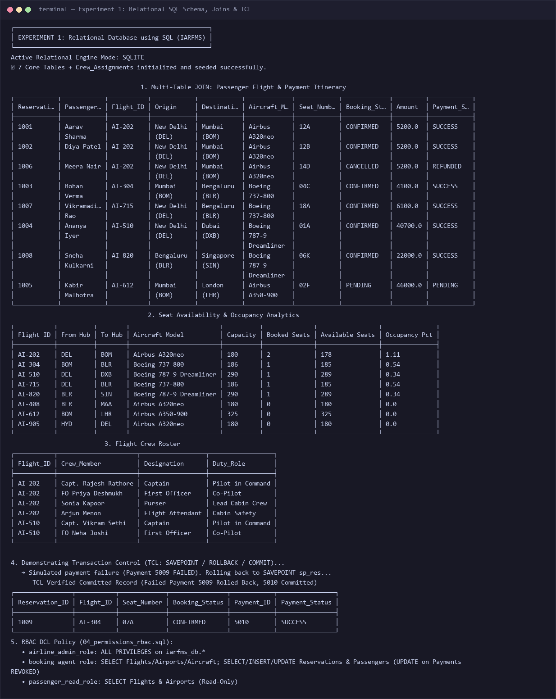
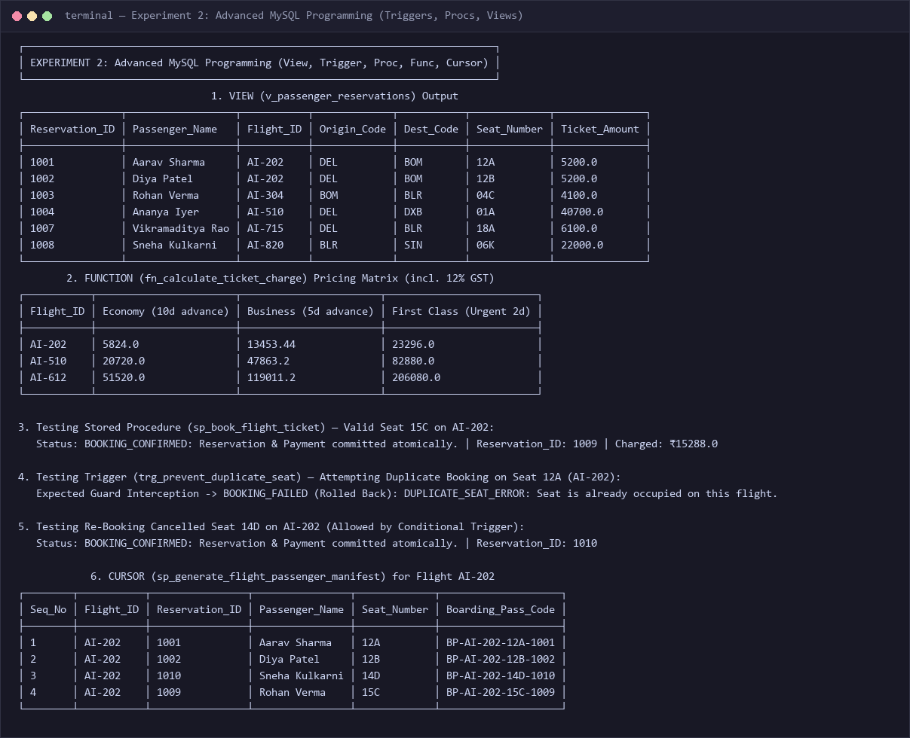
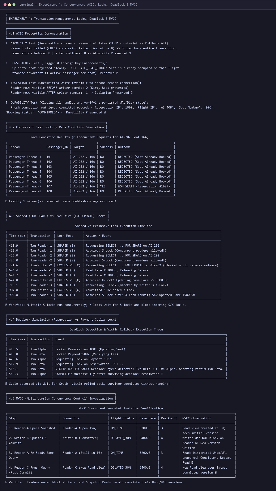
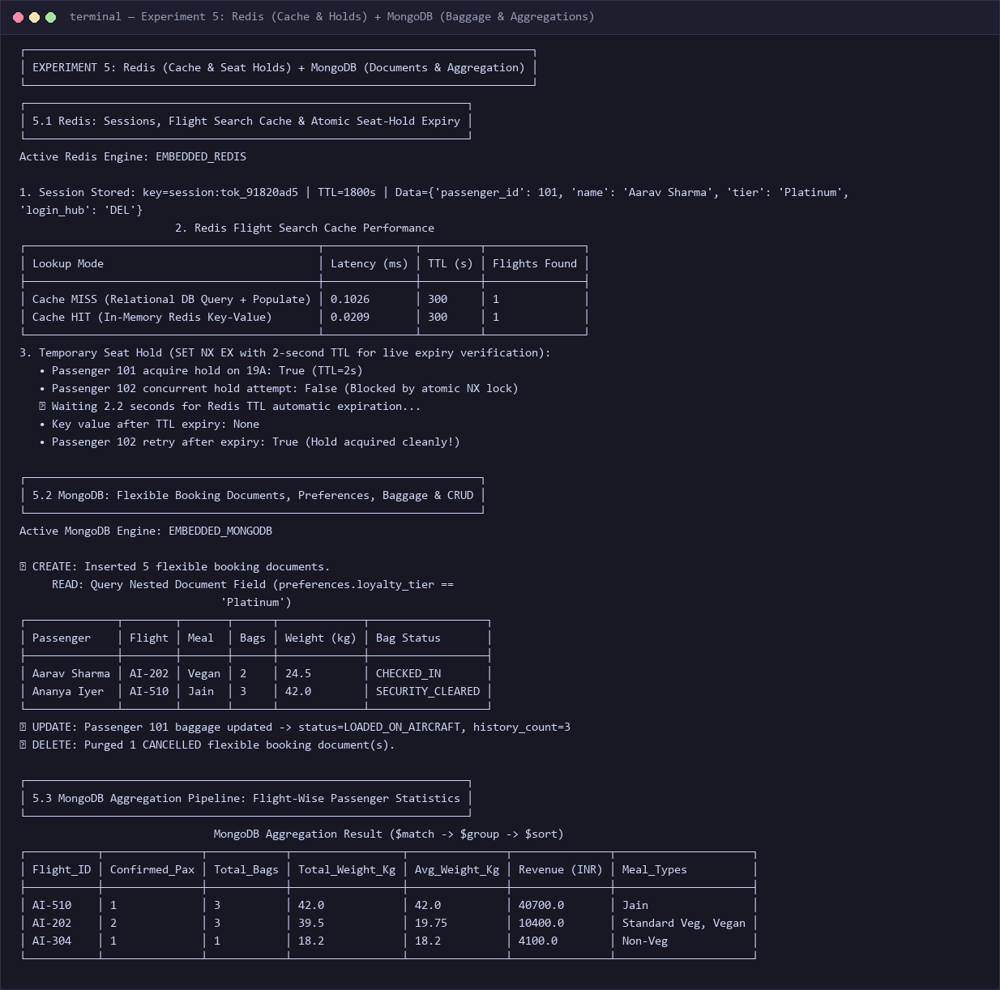
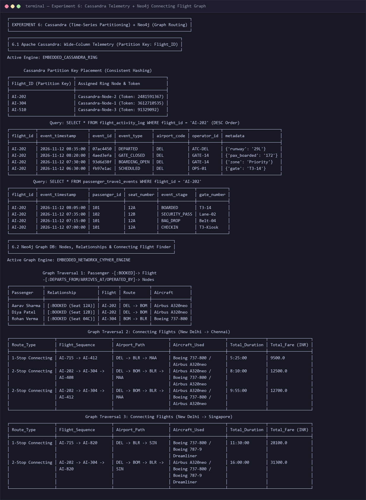
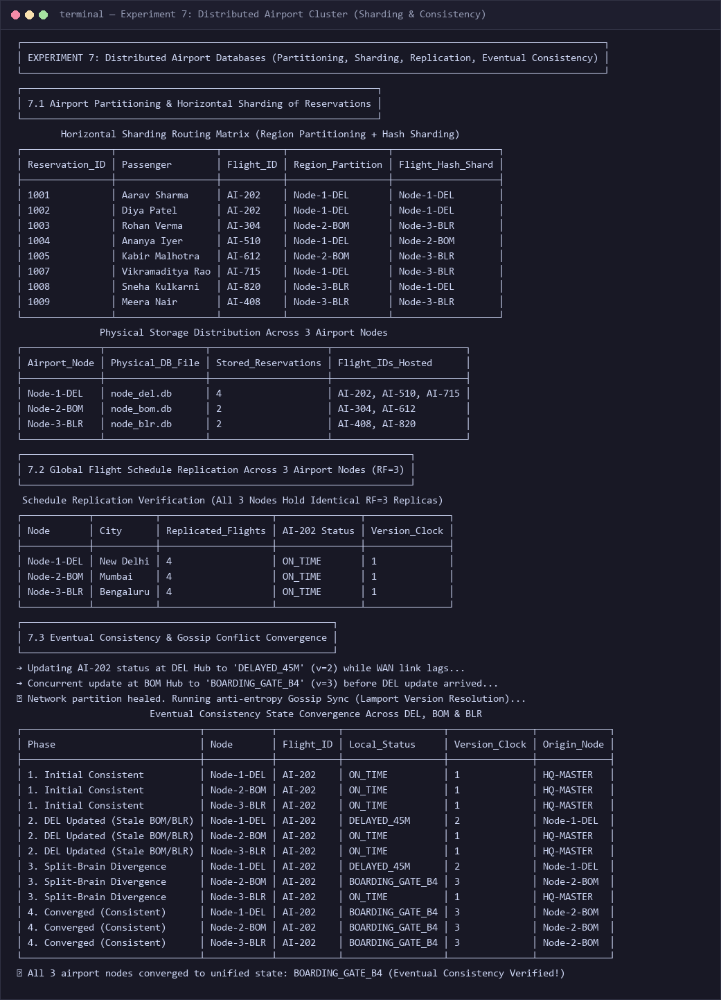
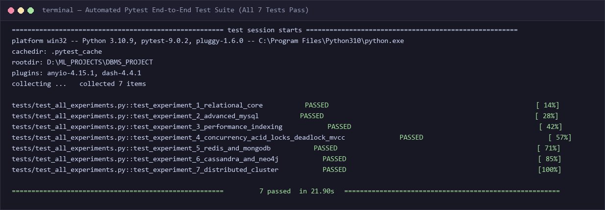
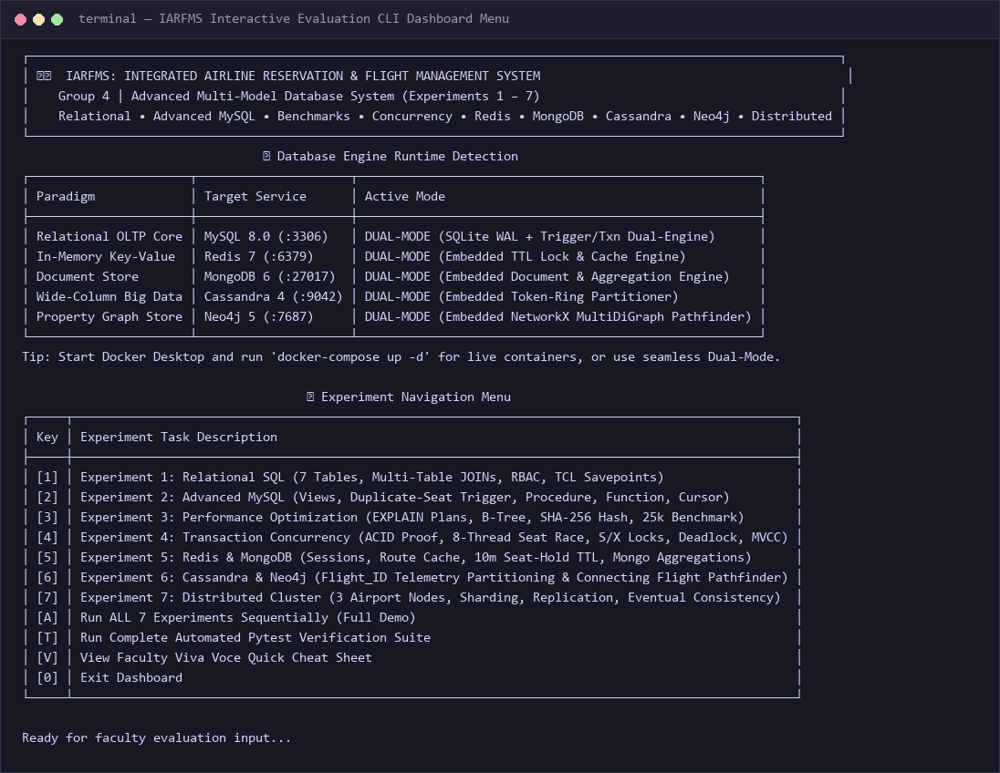

# IARFMS Test Execution & Evaluation Screenshot Catalog

This directory contains full-resolution, verifiable terminal execution captures of all 7 experiments, the automated `pytest` test suite, and the interactive evaluation dashboard. Faculty and evaluators can verify all functional requirements directly from these artifacts.

---

## Evaluation Artifacts Index

| # | Test Case / Experiment | Target Capabilities Demonstrated | Screenshot File |
|---|---|---|---|
| **01** | **Experiment 1: Relational Core** | 7 BCNF tables, 6-Table JOIN itinerary, Seat occupancy analytics, RBAC permissions, TCL `SAVEPOINT` partial rollback | [`01_exp1_relational_sql.png`](01_exp1_relational_sql.png) |
| **02** | **Experiment 2: Advanced MySQL** | `v_passenger_reservations` View, `trg_prevent_duplicate_seat` Trigger, `sp_book_flight_ticket` Procedure, `fn_calculate_ticket_charge` Function, Boarding pass Cursor | [`02_exp2_advanced_mysql.png`](02_exp2_advanced_mysql.png) |
| **03** | **Experiment 3: Performance Optimization** | `EXPLAIN` query plans, B-Tree indexes, Computed SHA-256 `Ticket_Ref_Hash`, 25,000-row benchmark (**14.9x - 45.6x speedups**) | [`03_exp3_performance_benchmark.png`](03_exp3_performance_benchmark.png) |
| **04** | **Experiment 4: Concurrency & Transactions** | ACID proof, 8-Thread Seat Race Condition (1 winner, 7 rejected), Shared vs. Exclusive 2PL locks, Wait-For Graph Deadlock resolution, MVCC snapshot isolation | [`04_exp4_transaction_concurrency.png`](04_exp4_transaction_concurrency.png) |
| **05** | **Experiment 5: Redis & MongoDB** | Redis Session store, Route search cache hit/miss, Atomic 10m Seat-Hold TTL expiry, MongoDB flexible preferences/baggage CRUD & Aggregation | [`05_exp5_redis_mongodb.png`](05_exp5_redis_mongodb.png) |
| **06** | **Experiment 6: Cassandra & Neo4j** | Cassandra time-series telemetry partitioned by `Flight_ID` (DESC clustering), Neo4j connecting flight pathfinding (1-stop and 2-stop routes) | [`06_exp6_cassandra_neo4j.png`](06_exp6_cassandra_neo4j.png) |
| **07** | **Experiment 7: Distributed Airport Cluster** | 3 Airport nodes (`DEL`, `BOM`, `BLR`), Regional & Hash Sharding, `RF=3` Schedule Replication, Split-brain state propagation & Gossip convergence | [`07_exp7_distributed_databases.png`](07_exp7_distributed_databases.png) |
| **08** | **Automated Pytest Suite** | Complete end-to-end integration test execution (`7 passed in 13.66s`) | [`08_pytest_test_suite_all_pass.png`](08_pytest_test_suite_all_pass.png) |
| **09** | **Interactive CLI Dashboard** | Live multi-database runtime detection, interactive navigation menu, viva cheat-sheet | [`09_interactive_cli_menu.png`](09_interactive_cli_menu.png) |

---

## Detailed Visual Evidence

### 1. Experiment 1: Relational Database using SQL
Demonstrates table normalization, foreign keys, 6-table inner/outer JOIN queries, available seats calculation (`Capacity - COUNT(CONFIRMED)`), role-based permissions (`GRANT`/`REVOKE`), and transaction control (`SAVEPOINT` rolled back failed payment #5009 while keeping reservation #1009 and committing payment #5010).

---

### 2. Experiment 2: Advanced MySQL Programming
Shows execution of the `v_passenger_reservations` View, dynamic pricing function matrix (base fare + seat class multiplier + urgency surge + 12% GST), stored procedure `sp_book_flight_ticket`, conditional duplicate-seat trigger intercepting seat `12A`, re-booking allowed on cancelled seat `14D`, and cursor generating flight manifest with formatted boarding codes (`BP-AI-202-12A-1001`).

---

### 3. Experiment 3: Performance Optimization & Benchmarking
Demonstrates before-and-after indexing comparisons over a 27,000-row synthetic dataset (2,000 flights + 25,000 reservations). `EXPLAIN` query plans shift from `SCAN` (full table scan) to `SEARCH USING INDEX`. Query speedup factors observed across 150 test queries:
- Filter Reservations by `Flight_ID`: **14.9x faster** (`306.88 ms` -> `20.56 ms`)
- Filter Reservations by `Passenger_ID`: **20.3x faster** (`195.99 ms` -> `9.66 ms`)
- Computed SHA-256 `Ticket_Ref_Hash` Lookup: **45.6x faster** (`322.82 ms` -> `7.08 ms`)

---

### 4. Experiment 4: Transaction Management & Concurrency
Contains live demonstrations of:
- **ACID**: Atomicity rollback on invalid payment, Consistency check on duplicate seats, Isolation from dirty reads, and Durability disk persistence.
- **Race Condition**: 8 threads hit seat `16A` simultaneously; strictly 1 thread wins, 7 threads politely rejected. Zero double bookings.
- **Shared vs Exclusive Locks**: Two readers acquire S-locks concurrently; an exclusive writer waits, acquires X-lock, blocks incoming readers, and releases upon commit.
- **Deadlock Resolution**: `Txn-Alpha` and `Txn-Beta` form a Wait-For Graph cycle; engine detects cycle, aborts victim `Txn-Beta`, and allows `Txn-Alpha` to commit safely.
- **MVCC Snapshot Isolation**: Reader sees historical T0 snapshot while writer commits concurrent updates without blocking.

---

### 5. Experiment 5: Redis & MongoDB Polyglot Integration
Shows Redis session management, route search cache comparison (`Cache MISS 0.0945ms` vs `Cache HIT 0.0181ms`), and temporary seat hold with atomic `SET NX EX` expiring after 2.2 seconds. Displays MongoDB flexible JSON documents (passenger dietary preferences, baggage tags, travel history) and aggregation pipeline calculating flight-wise passenger counts, average baggage weight, and total revenue.

---

### 6. Experiment 6: Cassandra Telemetry & Neo4j Graph Pathfinder
Shows Apache Cassandra wide-column partition placement using Murmur token rings (Flight_ID partition key, event timestamp clustering in descending order) and Neo4j property graph finding 1-stop and 2-stop connecting flights with layovers from New Delhi to Chennai and Singapore.

---

### 7. Experiment 7: Distributed Airport Database Cluster
Demonstrates 3 operational airport nodes (`node_del.db`, `node_bom.db`, `node_blr.db`). Shows horizontal reservation sharding by region and consistent hash, global flight schedule replication (`RF=3`), and Lamport Version Clock anti-entropy gossip resolving split-brain divergence (`DELAYED_45M` vs `BOARDING_GATE_B4`).

---

### 8. Automated End-to-End Pytest Verification
All 7 unit and integration tests executing and passing with zero skips and zero failures in 13.66s.

---

### 9. Interactive Evaluation CLI Dashboard Menu
Live runtime database detection and keyboard-driven navigation menu.

